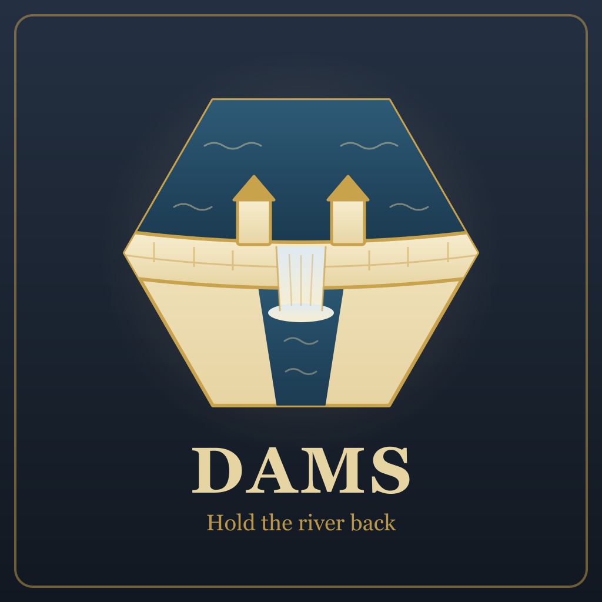
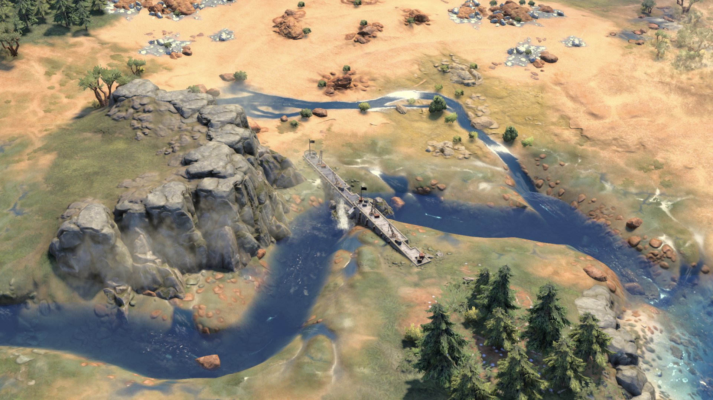
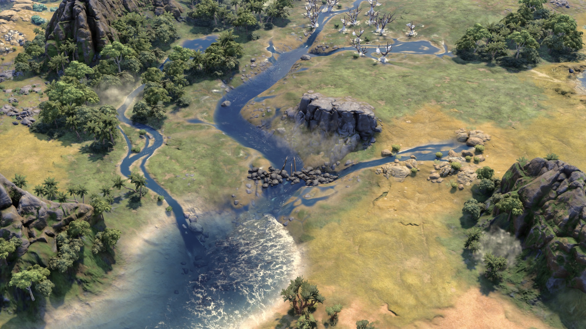
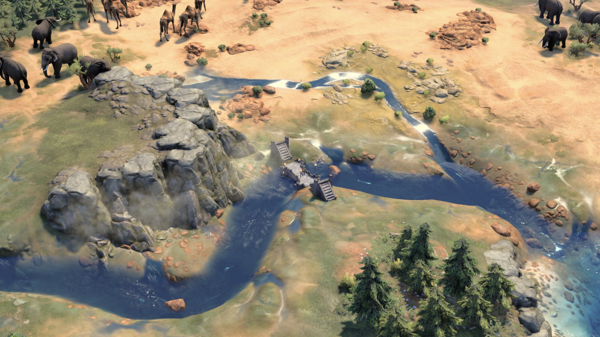

  

# Dams

A Civilization VII mod. Build a Dam on any river, navigable or not. It yields Food and Production, and once it is
finished, floods stop pillaging its settlement; each age's Dam holds back bigger floods than the last. In single
player the other settlements on the dammed river share the protection, and the price includes the valley: the river's
floodplains dry out, and the land beside it gives up its Food for good.

The Dam is an ordinary building in the production list, and a town buys it with gold like any other building. Each
age has its own Dam, unlocked by one of that age's techs. Single player and multiplayer play by the same rules.

*The Modern Dam, a concrete barrage with cranes along its crest. Each age has its own look.*

| Ancient Dam | Medieval Dam |
| --- | --- |
|  |  |
| A rough weir: two rows of boulders heaped across the channel, bank to bank. | Masonry: a stone ford with stairs down each bank and a gated arch for the flow. |

---

## What the player does

Pick the Dam in a settlement's production list and place it on a river tile, a navigable river or a land tile with a
minor river:

| Age | Building | Unlocked by | Production cost | Gold upkeep | Yields | Holds back |
| --- | --- | --- | --- | --- | --- | --- |
| Antiquity | Ancient Dam | Irrigation | 150 | 1 | +2 Food, +2 Production | Moderate floods |
| Exploration | Medieval Dam | Machinery | 275 | 2 | +3 Food, +3 Production | Moderate and major floods |
| Modern | Modern Dam | Electricity | 600 | 3 | +4 Food, +6 Production | Every flood, 1000-year floods included |

The Dam goes where the game lets the settlement put a building, so a young settlement is offered only the river tiles
beside its city center, and more as it grows. Any river can take one, and a settlement on two rivers can dam both.

Each Dam of an age a settlement already has adds about a quarter of the base cost to the next one there: +40
Production for an Ancient Dam, +70 for a Medieval Dam, +150 for a Modern Dam. With the Gold upkeep on every Dam, the
first is cheap and a settlement full of them is not. The game's AI pays the same price and weighs a Dam as it weighs
any other building.

The yields are set against the age's base buildings: a little under a Gristmill, Sawmill or Factory of the same age,
since a Dam also guards its settlement.

## What a Dam protects

The settlement holding the Dam is protected. The floods the Dam holds back no longer pillage its improvements,
buildings or districts; bigger floods still do damage as before. Protection covers the whole settlement rather than
one river, so a settlement on the dammed river and on a second river is protected on both.

The game has three sizes of flood: moderate, major and 1000-year. From the game's own tables, weighting each size by
how often it comes and by the share of flooded tiles it pillages (20, 40 and 60 %), the share of flood damage a Dam
prevents works out as follows:

| Dam | Floods held back | Damage prevented, by Disaster Frequency: Light (the default) / Moderate / Catastrophic |
| --- | --- | --- |
| Ancient | moderate | about 17 % / 29 % / 36 % |
| Medieval | moderate, major | about 50 % / 57 % / 73 % |
| Modern | moderate, major, 1000-year | all of it |

A flood bigger than a Dam can hold pillages the Dam itself if it reaches the Dam's tile: a major or 1000-year flood
overtops an Ancient Dam, a 1000-year flood a Medieval Dam. The Modern Dam is never overtopped. A pillaged Dam loses
its yields and its protection until it's repaired.

In single player and hotseat, every other settlement that owns a tile of the dammed river, another player's included,
gets a **Levee** in its city center, which carries the same protection as the best Dam on its river. The Levee arrives
on its own, outside the production list, and it doesn't take a building slot or need a citizen. A settlement founded
on the river later, or one whose borders reach it later, gets its Levee at the start of the next turn. When a newer
Dam is finished, the Levees along the river are raised to match; when it is razed, they fall back to the next best Dam
a turn later. In an online or LAN game each Dam protects its own settlement only.

## What a Dam costs

Production, a cost that rises with each Dam of the age already in the settlement, and Gold upkeep, everywhere. In single
player and hotseat also the valley: when the Dam finishes, the river's floodplains come off the map, whoever owns them.
Those tiles lose the floodplain's own Food, about 1 each, so a river with six floodplain tiles costs about six Food a
turn, permanently, and the floodplains do not return if the Dam is razed. On a river without floodplains, you only pay
the Production and Gold. In an online or LAN game the river keeps its floodplains.

Floods still happen on a dammed river, and they still leave silt behind: each flood permanently raises the Food or
Production of one to three of the river's tiles. The engine has no way to stop a flood or to take back what it
deposits, and [docs/DESIGN.md](docs/DESIGN.md) records the runs behind that. A Dam stops the damage, not the flood.

## Compatibility

- Adds three Dam buildings, three Levees and their tech unlocks through the game's database, so the base-game files
  stay as they are. The one change to base-game data: major and 1000-year floods get flood classes of their own, so a
  Dam can hold back one size and not another. Everything else that protects against floods (the Khmer Baray, the
  Water Puppet Theater, the Ho'okupu tradition, and other mods' flood immunity) is widened to match, so it still covers
  all three.
- A save loads with the mod on or off. A save from 1.3.0 still carries dam-site markers; they are lifted when it loads,
  and the woods, wetland or floodplain each one stood in for comes back.
- Dams plus a mod that turns floods off: the Dam still yields, and in single player still dries the floodplains, but
  its protection never comes into play.
- Translated into German, Spanish, French, Italian, Japanese, Korean, Polish, Brazilian Portuguese, Russian, and
  Simplified and Traditional Chinese, with the game's own words for its terms. Corrections to
  the translations are welcome.

## How it works

- Placement and price are all in the game's data: the game's own river rule, the one the Bridge and the Gristmill
  use, and the per-settlement rising cost the base game gives the Ancient Walls. The engine enforces both, for every
  player and in every kind of game.
- Protection is the Khmer Baray's flood immunity, given to any settlement holding a Dam or a Levee. The game files
  all three floods under one flood class, and the immunity is chosen by class, so the mod gives major and 1000-year
  floods classes of their own and each age's Dam names the ones it holds back. In single player, at load, at the start
  of each of the player's turns and whenever a Dam is finished, the mod reads every Dam off the map and places the
  right Levee in each settlement on its river (a pillaged Dam counts for nothing), and takes the floodplain features
  off a dammed river.
- Overtopping uses the game's own rule for which floods pillage which buildings, the one that has every flood
  pillage the Ancient Bridge, set per Dam for the floods it cannot hold.
- Each finished Dam is drawn across its river from the game's own models, one look per age: a rough weir of heaped
  boulders, a stone ford with a gated arch, a concrete barrage with a spillway. They grow with the age.

The design notes and the runs behind each step are in [docs/DESIGN.md](docs/DESIGN.md).

## Status

Tested in game on Civilization VII 1.5.0, through 1.3.0: placement on navigable and minor rivers, a build and its
completion, each age's protection against each size of flood (a settlement with no Levee pillaged by every flood, the
Ancient Levee holding moderate floods only, the Medieval Levee moderate and major, the Modern Levee all three), the
Levees rising to a newer Dam and falling back when it is razed, the dried floodplains, each age's look, the icons, a
save reloaded with the mod on, a Dam carried across the Exploration to Modern transition, and Compact Cities with its
ring lock on.

Tested in 2.0.0 (1 October 2026): the Ancient Dam locked until Irrigation and open once it is researched; an order on
a river tile with no marker; two Dams on one river in one settlement; the rising cost per settlement (a second
Medieval Dam 275 to 345, Modern 600, 750, 900); each age's yields and upkeep (+2/+2/-1 and +4/+6/-3, read in the
city); drying in single player; overtopping as described (an Ancient Dam pillaged by major and 1000-year floods, a
Medieval Dam holding majors and pillaged by a 1000-year flood, a Modern Dam holding everything); a settlement with a
pillaged Dam pillaged by a flood its Dam would hold; a 1.3.0 save loading with its three markers lifted and the
floodplain under one put back; the game's AI over 60 turns weighing the Dam about as it weighs a Gristmill and
building none; and a LAN game reading as a network game, with the mod on its network path.

Not yet tested in 2.0.0: a Dam offered and built in a network game (the hosted LAN game started once and offered no
tile, and the lobby did not start again in two more tries), Levees falling back when a Dam on a shared river is
pillaged, and the Medieval Dam's tech in a game that reaches Machinery.

## Installation

1. Subscribe on the Steam Workshop, or download the zip from the
   [latest release](https://github.com/tmtmiller1/civilizationvii_dams/releases/latest).
2. Unzip it so the `dams` folder sits in the Civilization VII Mods directory.
3. Enable **Dams** from Additional Content in-game.

## Civilopedia History Corrections

This mod also carries Civilopedia History Corrections, a text patch for
[Civilopedia Expanded: Independents](https://steamcommunity.com/sharedfiles/filedetails/?id=3815309882). With that mod
on, six East Asian history pages (Goguryeo, the Oirat, two Ryukyu pages, Nanzhao and Balhae) give each side where
historians in different countries disagree, and a few factual errors are fixed. With it off, the game's pages stay as
they are. The text is in `history-corrections/`, in English, Simplified Chinese and Traditional Chinese. Every Tower mod
that carries it writes the same text, so running several of them together is fine.

Those paragraphs were replaced because they didn't hold up. Some repeated Chinese state historiography as settled
fact, or recast a question most historians consider answered as still open. Some got basic dates and places wrong. And
the Oirat page called a genocide, the Qing destruction of most of the Dzungar people in 1755-1757, a "pacification."
I'm not leaving that in place. More corrections to Civilopedia Expanded may be added at any time, in any update.
Corrections may also be added for any other mod whose text I judge, in my sole discretion, to be bigoted,
genocide-denying or otherwise historically inaccurate. Running this mod alongside any of them means you accept those
replacements, including any added later. Switch this mod off and their pages read as their authors wrote them.

## Credits

By Tower.

## License

Up to version 2.0.3 this mod was MIT, and copies of those versions stay MIT. Versions after 2.0.3 are under the Tower
Mod License 1.0 in [LICENSE](LICENSE), written in plain English.

You're welcome to play it, read the code to see how it works, and change your own copy for your own games. If you'd
like to reupload it, put parts of it in your own mod, or use it some other way, ask me first: open an issue here or
message Tower on Steam. `ui/settings-keeper.js` stays MIT so other mods can keep embedding it.

I don't want this mod's code, text or art used to train AI models, collected into AI training sets, or handed to AI
tools to copy into other projects, and the license doesn't allow it without my written permission. I also reserve the
rights to text and data mining of this work under Article 4(3) of the EU's Directive 2019/790.

Because the source is on GitHub, GitHub and its affiliates (Microsoft included) have their own license to it under
GitHub's Terms of Service, and since April 2026 that covers training their AI. Valve and Take-Two have the rights
their own terms give them. Sid Meier's Civilization VII and its assets belong to Firaxis Games and 2K. Material from
other people is listed in [LICENSE](LICENSE).
